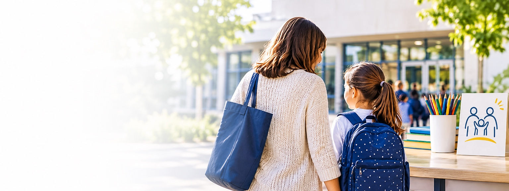

# APEE — Cabeçalho fotográfico com desfoque à esquerda (modelo aprovado)

**Referência:** página `familias.html`, versão visual aprovada em 09-11-2026, CSS `familias-foto-subida-desfoque-20261109-v10`.

**Estado:** modelo de referência guardado; este ficheiro não altera o aspeto do site. O código usado no site continua em `proposta/site.css`.

## O que preservar
- A **imagem original** sem regenerar, esticar ou cortar. O CSS mantém a proporção da imagem através de `object-fit:contain`, `aspect-ratio:8/3` e posição à direita.
- Fotografia **subida**, enquadrada junto ao título, mantendo todas as partes da fotografia visíveis.
- **Título e subtítulo sem caixa** à volta; névoa/desfoque gradual apenas à esquerda, diretamente por trás das letras, sem esconder o assunto principal à direita.
- Formatação adaptada à versão **desktop** e à versão **móvel** (breakpoint 760 px).
- Preservar sempre os elementos de navegação e a acessibilidade da página.

## HTML de referência da página Famílias

```html
<main id="conteudo">
  <div class="page-hero family-photo-hero">
    
    <div class="container family-photo-hero-text">
      <span class="eyebrow">APEE · Bairro do Restelo</span>
      <h1>Famílias</h1>
      <p>Informação prática, apoio à família e iniciativas de proximidade.</p>
    </div>
  </div>
</main>
```

## CSS exatamente como aprovado e publicado

Fonte: secção final do ficheiro `proposta/site.css` na versão aprovada.

```css
/* Famílias 2026: imagem original, sem recorte ou estiramento.
   Título sem caixa e névoa/desfoque suave apenas na esquerda. */
main#conteudo > .page-hero.family-photo-hero{
  position:relative;
  isolation:isolate;
  overflow:hidden;
  display:flex;
  align-items:center;
  min-height:clamp(410px,37.5vw,560px);
  padding:40px 0;
  border-bottom:1px solid #dce9f5;
  background:#f6f9fc;
}
main#conteudo > .page-hero.family-photo-hero .family-photo-hero-image{
  display:block;
  position:absolute;
  z-index:0;
  right:0;
  top:0;
  bottom:auto;
  width:100%;
  height:auto;
  max-width:100%;
  aspect-ratio:8/3;
  object-fit:contain;
  object-position:right top;
  filter:none;
}
main#conteudo > .page-hero.family-photo-hero::before{
  content:"";
  display:block;
  position:absolute;
  inset:0;
  z-index:1;
  width:auto;
  height:auto;
  border:0;
  border-radius:0;
  background:linear-gradient(90deg,rgba(248,251,255,.96) 0%,rgba(248,251,255,.86) 24%,rgba(248,251,255,.49) 45%,rgba(248,251,255,0) 72%);
  -webkit-backdrop-filter:blur(8px);
  backdrop-filter:blur(8px);
  -webkit-mask-image:linear-gradient(90deg,#000 0%,#000 26%,rgba(0,0,0,.6) 47%,transparent 73%);
  mask-image:linear-gradient(90deg,#000 0%,#000 26%,rgba(0,0,0,.6) 47%,transparent 73%);
  pointer-events:none;
}
main#conteudo > .page-hero.family-photo-hero::after{content:none;display:none}
main#conteudo > .page-hero.family-photo-hero .family-photo-hero-text{
  position:relative;
  z-index:2;
  flex:none;
  width:min(445px,calc(100% - 48px));
  margin-left:max(24px,calc((100% - 1150px)/2));
  margin-right:auto;
  padding:0;
  border:0;
  border-radius:0;
  background:transparent;
  -webkit-backdrop-filter:none;
  backdrop-filter:none;
  box-shadow:none;
}
main#conteudo > .page-hero.family-photo-hero .family-photo-hero-text p{
  color:#3c5b77;
  max-width:410px;
  line-height:1.58;
}
@media(max-width:760px){
  main#conteudo > .page-hero.family-photo-hero{
    display:flex;
    align-items:flex-start;
    min-height:225px;
    padding:23px 0 20px;
    background:#f6f9fc;
  }
  main#conteudo > .page-hero.family-photo-hero .family-photo-hero-image{
    width:100%;
    height:auto;
    max-width:100%;
    top:42px;
    right:0;
    bottom:auto;
    object-fit:contain;
    object-position:right top;
    aspect-ratio:8/3;
  }
  main#conteudo > .page-hero.family-photo-hero::before{
    background:linear-gradient(90deg,rgba(248,251,255,.97) 0%,rgba(248,251,255,.87) 27%,rgba(248,251,255,.58) 50%,rgba(248,251,255,.13) 79%,transparent 100%);
    -webkit-backdrop-filter:blur(9px);
    backdrop-filter:blur(9px);
    -webkit-mask-image:linear-gradient(90deg,#000 0%,#000 25%,rgba(0,0,0,.78) 54%,transparent 93%);
    mask-image:linear-gradient(90deg,#000 0%,#000 22%,rgba(0,0,0,.68) 49%,transparent 87%);
  }
  main#conteudo > .page-hero.family-photo-hero .family-photo-hero-text{
    width:min(330px,calc(100% - 36px));
    margin:0 18px;
    padding:0;
    border:0;
    background:transparent;
    box-shadow:none;
    -webkit-backdrop-filter:none;
    backdrop-filter:none;
  }
  main#conteudo > .page-hero.family-photo-hero .family-photo-hero-text p{
    max-width:305px;
    font-size:1rem;
    line-height:1.53;
  }
}
```

## Como reutilizar noutras páginas sem afetar a página Famílias

1. Copiar o HTML do cabeçalho para a página de destino. **Não copiar o elemento `<main>` se já existir**.
2. Utilizar uma classe própria para o novo cabeçalho, por exemplo `escola-photo-hero` em vez de `family-photo-hero`, e atualizar consistentemente as três classes de imagem e texto.
3. Copiar este CSS e substituir `family-photo-hero` pelo novo nome de classe. Evita que alterações futuras mudem o cabeçalho «Famílias» aprovado.
4. Trocar apenas a fotografia, os textos e o atributo `alt`. Se a fotografia tiver proporção diferente de **1536 × 576 (8:3)**, ajustar `aspect-ratio` à imagem original, sem forçar a imagem.
5. Atualizar a versão do endereço `site.css?v=...` na página e publicar.
6. Antes de concluir cada alteração, verificar visualmente a **versão móvel** (ex.: 390 px) e a **desktop** (ex.: 1440 px), incluindo posicionamento da imagem, legibilidade e ausência de cortes.

## Identificação do modelo

**Nome curto para pedir em conversa:** «Cabeçalho Famílias — fotografia panorâmica, desfoque à esquerda e sem caixa».

**Site de referência:** https://apeebairrodorestelo.com/familias.html
